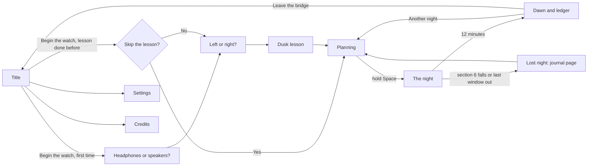

# EXPERIENCE.md — The Mourning Watch (one-night game)

How the game's surfaces behave. How they look is in [DESIGN.md](DESIGN.md); tokens are cited as `{path.to.token}`. Both documents win over any mock on conflict. Rules of play (timings, costs, what the dead do) stay in the GDD and are cited, not repeated. Decision numbers (UX-n) point into `.decision-log.md`.

## Foundation

- **Form factor.** Windows and Linux PC at a desk. Monitor at 1080p or 720p, keyboard and mouse only, stereo on headphones or speakers. No gamepad, no couch distance, no handheld in the one-night game (GDD GD-22).
- **Engine.** Godot 4.7.2, Forward+. Screen UI is Control nodes under one Theme built from DESIGN.md's tokens, on a 1920×1080 canvas with `canvas_items` stretch. Everything the warden reads at night is a 3D object in the scene, not a Control.
- **Two kinds of surface.** *Screens* (title, first-launch questions, planning, pause, settings, journal, dawn ledger) may draw text. *The night* may not, with one named exception: the ally's caption (UX-1).
- **Stakes.** Hobby: a free solo release to a good standard (UX log).
- **Standing rule.** Every visual cue points to a sound; it never replaces one (GDD pillar 2).

## Information Architecture

Pause (Esc) is reachable from the dusk lesson, planning, the night and dawn, and holds: Resume · Keys · Journal · Settings · Leave the bridge. From Pause, Leave the bridge asks first ("Leave the bridge? Nothing is kept." · Stay · Leave), because nothing is saved (UX-24). At dawn it does not ask.

| Surface | Reached from | Holds | Leaves to |
|---|---|---|---|
| Title | Launch; Leave the bridge | Begin the watch · Settings · Credits · Quit | First-launch questions, skip question, Settings, Credits, desktop |
| Headphones or speakers? | Begin the watch, first launch only | One question, two choices. The answer changes no cue; it is kept in Settings and written to the playtest log. Speakers adds one line: "Best with headphones." (UX-19) | Left or right? |
| Left or right? | Previous screen; Settings → Check left and right | One bell stroke, two choices, and a quieter third answer, "I can't hear it", which offers "Show cues everywhere" and continues (UX-38). R rings the bell again. After two wrong answers: the swap offer, the single-channel warning, and the same cues offer | Dusk lesson (or back to Settings) |
| Skip the lesson? | Begin the watch, once the lesson has been finished on this machine (a flag kept with the settings, not a save game). First-timers are never asked. | Two choices. Skipping also skips the left/right check (UX-21) | Planning, or Left or right? |
| Dusk lesson | Left or right? | First person; the ally's captions; key prompts | Planning |
| Planning | Dusk lesson; lost night; Another night | The span from above; the tool tray; why-line; Journal; Keys | The night |
| The night | Planning | First person; captions only | Dawn, or lost night |
| Lost night | The night | Dark, then the journal page with the new hint | Planning |
| Dawn and ledger | The night | The span from above; the ledger page; two menu-items: Another night · Leave the bridge | Planning, or Title |
| Pause | Esc | Five entries | Where it came from, or Title |
| Settings | Title; Pause | Sound · Cues · Controls · Display | Back |
| Journal | Planning (click or J); Pause; lost night. Never carried or opened as an object at night. | Hints earned so far | Back |
| Keys | Planning tray; Pause | The key card | Back |
| Credits | Title | Asset licences; the AI-use disclosure | Back |

Nothing is deeper than two steps from play (Pause → Settings). There is no save and no Continue (GDD: one sitting, no save).

**What the player needs, and where it lives at night** is in HUD & Diegetic UI below.

Mocked in [mockups/key-screens.html](mockups/key-screens.html): Planning, Dawn and ledger, Pause, Settings, Lost night, Journal. Built from the tables alone: Title, the two first-launch questions, Skip the lesson?, the leave question, Keys, Credits, the dusk key-prompt and the night caption (the last two appear in [mockups/directions-1.html](mockups/directions-1.html), direction C).

## Voice and Tone

Spare and in-world for anything the warden would say or read; plain and literal for anything that configures the machine (UX-31).

| Where | Voice | Examples |
|---|---|---|
| Menu entries, tray actions, closing choices | Short quiet declaratives in the warden's register | "Begin the watch" (the title's Start entry) · "Ring the bell" · "Start over" · "Another night" · "Leave the bridge" |
| Ledger | Counts stated flatly; one line that is not a count | "Sections standing · 3 of 6" · "The fallen will return." |
| Journal hints | One or two plain sentences, written as a note to oneself, about cause and never about score | (the six are written in GDD epic 5) |
| Why-line | What is needed, then what you have | "Trapdoor needs 2 ropes. You hold 1." · "Nothing can be built on section 6." |
| Settings, first-launch questions, warnings | Plain and literal, no fiction | "Mouse sensitivity" · "Swap left and right" · "Your sound may be coming from one channel only." |
| Captions | Exactly the ally's spoken words | "Below!" · "Above!" · "In the walls!" |

Never: exclamation marks outside the ally's lines; "Game over"; "You win"; "Victory"; scores, grades or percentages; second-person coaching ("Try to…") outside the journal.

## Component Patterns

Visual specs are in DESIGN.md, Components, under the same names.

| Component | Behaviour |
|---|---|
| **menu-item** | Up/Down or W/S moves the choice; Enter, Space or a click confirms; Esc goes back one step. Pointer hover and keyboard choice are the same state: moving the pointer onto an entry chooses it. The first entry is chosen when a menu opens. Used for the title, pause, the skip question, the leave question and the dawn's two closing choices. |
| **tool-tray** | Always visible in planning. Parts in hand update the moment a strip, placement or undo happens. |
| **tray-tool** | 1, 2, 3 or a click chooses trapdoor, swing-beam, lantern. Pressing the chosen tool's number again, or Esc, puts it away (UX-16). A tool that cannot be afforded, or has none left to place, is unavailable but can still be pointed at to read why. |
| **why-line** | Appears while the pointer is on an unavailable tool, or on a section where the chosen tool cannot go; names the missing thing (UX-15). Empty otherwise. |
| **hold-control** | Acts only after a full 1 s hold of its key (Space for Ring the bell) or of the left mouse button on the entry (Ring the bell, Start over). Ring the bell starts the night (UX-18). Start over restores the whole span to dusk: every plank and rope back, every rig and placed lantern removed (UX-17). Releasing early does nothing. |
| **span-section** | Planning, no tool chosen: a click anywhere on the deck strips the next plank in the fixed order the night also uses (which plank is cosmetic; strength is a count, UX-8); a click on a rail strips that rail (UX-16). With a tool chosen: a click places it; for a swing-beam the click is on the rail it will hang from (UX-9). Right click undoes the last choice on that section (UX-17). Section 6 refuses rigs and stops at 4 planks (GDD mechanic 2), each with a why-line. |
| **rig-mark** | Shows which section the rig covers. Right click on its section removes it and returns its cost. |
| **lantern-reach** | Appears while the lantern tool is chosen (as a preview under the pointer) and stays for each placed lantern. |
| **caption-line** | Shown for every spoken ally line, always, in every cue mode (UX-1, UX-3). On for as long as the line is spoken and at least 2 s. One at a time, matching the ally's one-call rule, with at least 0.3 s between two captions. Says only what the voice says (UX-26). |
| **ledger-page** | Seven lines in the GDD's order (Win/Loss Conditions), written in one at a time, top to bottom, about one per 1.5 s; any key or click completes the page at once. Formats: "Sections standing · n of 6"; "Windows lit · n of 12"; "Planks and ropes left · n, n"; "Wounds taken · n"; "Names learned · " the name with its epitaph beneath, or "None"; "Souls released · One" or "None"; and last, "The fallen will return." (no value, never a number) (GDD GD-53). The two closing menu-items appear only when the last line is in; Another night is chosen. |
| **journal-page** | Opens on the newest hint. Does not exist (no tray entry, no pause entry) until the first hint is written (UX-13). |
| **key-card** | Read-only. Lists every key under Night, Planning, Always, each with its condition where it has one (for example "1, 2, R: at a section's town-side edge, facing out"). A fourth group, Signs, lists what the world is saying: shaking ropes, swirling fog, falling dust, a leaning flame, bowing planks, a sputtering flame. |
| **key-prompt** | Dusk lesson only (UX-22). Each prompt stays until its action has been done once, then never returns. |
| **setting-row** | Left/Right or a click changes the value; changes apply at once and are kept between launches. |
| **two-choice** | A or Left arrow picks the left word, D or Right arrow the right one, or click either (UX-20). The left/right check adds a third, smaller answer below, "I can't hear it", and R to ring again (UX-38). |
| **centre-dot** | Off by default; a Settings choice (UX-5). When on, it is visible in first person only. |
| **town-window** | In the dawn view the twelve windows show the final count. |

## State Patterns

| Surface | State | What happens |
|---|---|---|
| Title | Cold start | Reached in 10 s or less (GDD). "Begin the watch" is chosen. |
| Left or right? | Wrong twice | Offers "Swap left and right" and warns that sound may be single-channel (GDD). Either answer continues. |
| Dusk lesson | Opening | The first cry starts within 15 s of the lesson opening and is itself the look lesson: the look key-prompt shows while it repeats. Walking is prompted after the first cry is faced. With the two first-launch questions this keeps the GDD's "first cry within 60 s of Start". |
| Dusk lesson | A cry not yet faced | It repeats until the warden faces within 45°. After each playing not faced the ally says "listen again"; after three, the place shows its cue, which the lesson holds back until then (GDD). |
| Dusk lesson | Hands-on part | After the three cries: strike a practice pin on the landing, strip a plank, hang and shutter the lantern, raise the forearm, each with a key-prompt (UX-22). |
| Planning | Fresh span | 48 planks, 12 ropes on the span; nothing in hand; no tool chosen; tools 1 and 2 unavailable until parts are stripped. |
| Planning | After a lost night | The plan the lost night was started with is restored exactly: stripped parts, rigs, lanterns (UX-40). Start over wipes it. The Journal entry is in the tray. The name and its section are rolled again and the forearm is blank (GDD GD-52). |
| Planning | A lantern still to place | Ring the bell is unavailable and says why (GDD mechanic 10). |
| Planning | Tool unavailable | `{colors.dim}`; why-line on point. |
| Planning | Nothing left to undo on a section | Right click does nothing. |
| Night | Usable thing within 2 m | The matching hand moves to its ready pose (UX-5). |
| Night | Holding | The action is its own progress; no bar (UX-2). |
| Night | Hold cancelled | The hand lets go and drops back, with a slack or dropped-tool sound (UX-6). Same for mouse and keys. |
| Night | Action impossible | The hand reaches, stops short and opens empty, with a dull knock (UX-6). Same for mouse and keys. No text: the reason is read from the forearm tallies or the object itself. |
| Night | Forearm raised | Walk and look; no hand actions until Tab is released; Tab is ignored during a hold (UX-11). |
| Night | Wounded | That ear is dulled and that side of the view darkens for 20 s (GDD). |
| Night | Knocked down, hanging, crossing a gap | The view shows it; no input but look until it ends (GDD timings). |
| Night | Lantern near empty | Flame shrinks and sputters; the reservoir shows low. Look and sound only: the light's reach does not change (UX-7). |
| Night | Lantern shuttered | Glows through its seams. Empty: dark (UX-7). |
| Night | Name uncovered and lit | Looking at it within 2 m for about 1 s reads it; the forearm rises once on its own (UX-10). |
| Lost night | New hint | Cries cut to wind, the view goes dark, the journal page opens on the new hint being written; one action continues (UX-12). Planning is ready within 3 s of that action (GDD). |
| Lost night | Cause already has its hint | Same beat, but nothing is written: the journal opens on that cause's hint, already there, brightened for a moment (UX-41). |
| Dawn | — | Every cry stops. The view rises over the span. After the silence the ally speaks one line, then the ledger is written in, ending on "The fallen will return." (UX-14, GDD GD-53). |
| Pause | Any | Clock, the dead and every sound stop. Resume continues from the same instant. The playtest build writes each pause to its log (UX-24). |
| Journal | No hints yet | Not offered anywhere. |
| Settings | Cues set to Ears only or Everywhere | One line under the choice says what it changes. |

## Interaction Primitives

- **Look decides.** At night the action comes from what the warden looks at within 2 m (GDD). This holds for both mouse hands and for E (UX-36).
- **Ready pose.** A hand that can act shows it before the input: hammer raised to a pin, rope hand open to a rope, tool taken out at a build spot. No pose means no action there (UX-5, UX-9).
- **Hold.** Most night actions are holds of 2 to 12 s (GDD key map). A hold cancels on moving more than 0.5 m or on a wound; looking around is free. Parts are spent when the hold completes, not when it starts. Pause freezes a hold and does not cancel it. Progress is the animation and its sound, ending on a distinct final beat (UX-2). With Holds set to Press once, a press starts the hold and a second press stops it (UX-39). Planning's two 1 s holds stay holds.
- **Stand, face, look.** 1, 2 and R act on the section ahead when the warden stands at its town-side edge facing out. A swing-beam takes the rail on the side the warden is looking toward when the hold starts (UX-9).
- **Dwell to read.** About 1 s of looking reads the carved name (UX-10). Nothing else in the game uses dwell.
- **Raise to read.** Tab held raises the forearm (UX-11).
- **Hold to commit.** In planning, the two actions that throw work away are 1 s holds: Ring the bell, Start over.
- **Ask before leaving.** Leave the bridge from Pause asks once.
- **Right click takes back**, in planning only.

## HUD & Diegetic UI

The night has no HUD. The table is the whole of what the player can know at night and the object or sound that carries it. "In light" means visible only where light falls: the three lanterns and the town gate (UX-29). The gate's light cannot be shuttered or moved, so section 6's cues and the tally board are always readable.

| The player needs to know | Carried by | Decision |
|---|---|---|
| What a click will do | The hands' ready pose | GDD, UX-5 |
| What E, F, 1, 2, R will do | Partly practised at dusk, otherwise learned from the key card; the ready pose at a build spot; a "can't" gesture when impossible | UX-4, UX-6, UX-9 |
| Progress of a hold | The action's own animation and sound | UX-2 |
| Planks and ropes in hand | Tally strokes inked on the forearm (Tab) | GDD, UX-11 |
| The name, once read | Written on the forearm (Tab) | GDD, UX-10 |
| A section's strength | Its planks, drawn as planks, in light | UX-8 |
| A section near breaking | Creak and groan; planks bow, in light | GDD |
| Oil left | The lantern's reservoir, and a shrinking, sputtering flame | UX-7 |
| The spare flask | Seen at the town pier, full or empty; it is never carried and refills one lantern once | UX-36 |
| A cry's level | Kind of cry; shaking ropes, swirling fog, falling dust (rattling planks for a hook on the deck), in light; the ally's call with caption | GDD, UX-1 |
| A cry's side | Stereo; a lit flame leaning toward it, in its own light | GDD |
| The name's section | The hum; the carried flame leaning toward it within 3 m, only while the hum can be heard (no cry sounding) | GDD, UX log |
| The one who keeps coming back is here | The tune; its rail's ropes swaying in time, in light | GDD |
| Which wave | Count of tolls; chalk tallies on the board at the town pier | GDD |
| Which way is home | The bell's side; the warm windows | GDD |
| Windows left | The windows themselves; a small sound from the town as each goes out | GDD, UX-30 |
| A lone hatchling got through | A window flickers low; a fainter window sound | UX-37 |
| Wounded | One ear dulled; that side of the view darkened | GDD |
| The ally spoke | Voice and caption | UX-1 |

**The one overlay.** The caption line (and the centre dot, if switched on). Nothing else is ever drawn over the night view: no prompts, markers, bars, timers, counters or damage flashes.

**The three cue modes** (one setting, UX-25):

| | In the light (default) | Everywhere | Ears only |
|---|---|---|---|
| Pointer cues: shaking ropes, swirling fog, falling dust, swaying ropes, leaning flames | Where light falls | Everywhere: the cue itself glows faintly in the dark and nothing else is revealed; flames lean to cries beyond their light (UX-27) | Off (UX-3) |
| Flames dip once for each stroke of the bell | No | Yes (UX-28) | No |
| Footsteps of the dead on the deck; bowing planks | Where light falls | Also glow faintly in the dark (UX-38) | Where light falls |
| A shuttered lantern | No lean | Its seam glow still leans (UX-38) | No lean |
| The ally's calls | Every warning in waves 1 to 3; from wave 4 only warnings the warden has not turned to (GDD) | Every warning, 2 s in, all night (UX-38) | As default |
| Captions, wound darkening, chalk tallies, bowing planks, things seen in the light | On | On | On |

A pointer cue lasts for the whole of its warning, in every mode that shows it.

**Seen without a lantern.** The warden's hands and forearm keep a minimum brightness, so the ready pose, a hold, a "can't" gesture and the tallies stay readable with the lantern shuttered, empty or hung elsewhere.

**Left as the GDD has it, on purpose:** distance has no visual cue of its own; a lull has no signal but quiet; whether the bell would work "now" is heard in the tune and not shown. A hook already shaken once gets no ready pose and answers a strike with the "can't" gesture.

## Input Schemes

Keyboard and mouse only. The bindings are the GDD's key map (Controls and Input); this section adds only what UX decided.

| Input | Where | Adds to the GDD |
|---|---|---|
| E | Night | Acts on what is looked at: a pole (hang the lantern in hand, take the one hanging there, or swap the two; one lantern in hand, GDD GD-49); a standing section with fewer than 8 planks, with a plank in hand (re-lay); the flask at the town pier with a lantern in hand (refill). (UX-36) |
| 1, 2, R | Night | Valid only at a section's town-side edge, facing out; the ready pose says so. 2 takes the rail looked toward. (UX-9) |
| Tab | Night | Walk and look allowed; hands busy; ignored during a hold. (UX-11) |
| Space | Planning | A 1 s hold, not a tap. (UX-18) |
| 1, 2, 3 | Planning | Pressing the chosen tool again puts it away. (UX-16) |
| J | Planning | Opens the journal, once it exists. (UX-13) |
| Esc | Planning | Puts a chosen tool away first; with no tool chosen, pauses. (UX-16) |
| Esc | Everywhere else | Pause; in a menu, back one step. (UX-24) |
| A / D, Left / Right, click | Two-choice screens | Answer. (UX-20) |

- **No rebinding** in the one-night game (UX-25); keys are bound by physical position. **Holds: Press once** is a setting (UX-39).
- **No prompts at night** and no key glyphs to adapt: there is one input device. Key names appear only in the dusk key-prompts, the tray, and the key card.
- Mouse sensitivity and invert look are in Settings.

## Game Feel & Juice

Feedback is physical and audible; nothing flashes on the screen.

| Moment | Response |
|---|---|
| A hold in progress | Counted hammer blows, rope coming in hand over hand, a plank levering up: a rhythm the player can count, closing on a heavier final beat. |
| A rig sprung | The pin or rope gives under the hammer; the rig reacts within 0.3 s (GDD); then the falling cry fading over 2 s, the payoff (GDD). |
| Cancel | The hand releases; slack rope or a dropped tool sound. |
| Can't | The hand stops short and opens empty; a dull knock. |
| Name read | The forearm rises on its own; a pen-scratch as the name is inked; it lowers. |
| Right ring | The tune resolves; the dead stand still (GDD). |
| Wrong ring | Only the bell, and the dead quicken (GDD). |
| Window out | One short, quiet sound from the town side, well under the cries, outside the four-cry limit (UX-30). |
| Start of the night | The warden's bell under the held Space, then the town's bell answers with one toll (UX-18). |
| Lost night | Every cry cuts to wind; dark; the scratch of the hint being written. |
| Dawn | Silence first. Then the ally's one line. Then the ledger, a line at a time, closing on the vow. |
| Planning | A strip, a placement and an undo each have a short dry sound (wood, rope, iron). No music anywhere (GDD). |

No screen shake, no hit-stop, no vignette other than the wound's darkened side, no controller haptics (no controller).

## Accessibility Floor

At hobby stakes the floor is what the GDD promises plus cheap basics.

**Provided**

- A visual cue for every sound (GDD), with three cue modes, including **Cues everywhere** for players who cannot rely on hearing.
- **Captions always on** for every spoken line, with three sizes.
- **Left/right check** at first launch, a **swap** setting, and a single-channel warning; the check can be re-run from Settings.
- **Stream-safe sound** (GDD: cries lifted 6 dB above everything else).
- **Centre dot** and a **field of view** slider for motion comfort; mouse sensitivity; invert look. The camera has no bob and no roll.
- **Holds: Press once.** A press starts a hold and it runs to its end unless the warden moves 0.5 m or is wounded; same durations. Tab becomes a toggle (UX-39).
- **Brightness** slider with a "barely visible" calibration mark.
- **Mono sound** for single-ear listeners; choosing it suggests Cues everywhere, since direction by ear is lost.
- **Keys by position.** Keys are bound by physical position, so WASD and the number row sit in the same place on any layout, and key names are shown as that keyboard prints them.
- **Full pause** at any time, in every phase.
- Text never smaller than `{typography.label}`; contrast as stated in DESIGN.md, Colors; no meaning carried by colour alone; every screen readable in greyscale.
- No full-screen flash and no screen shake. Full-view changes are slow fades only: the wound's darkened side, the lost night's dark, the dawn. Flames are the only flicker: a sputter stays on the flame itself, nothing repeats faster than 3 times a second, and a toll dip takes about 0.8 s.
- No timed reading: the ledger and journal wait for the player; planning is untimed.

**Settings list** (UX-25, UX-39)

| Group | Settings |
|---|---|
| Sound | Volume · Headphones or speakers · Swap left and right · Check left and right · Stream-safe sound · Mono sound |
| Cues | Visual cues: In the light / Everywhere / Ears only · Centre dot |
| Controls | Mouse sensitivity · Invert look · Holds: Hold / Press once |
| Display | Fullscreen or window · Resolution · Brightness · Field of view · Fog quality · Caption size |

**Known gaps, accepted for the one-night game**

- No key rebinding. One-handed play is not served.
- Without hearing, the hum and the tune are reachable only through the leaning flame and the swaying ropes, and a window going out behind the warden has no cue in view. Calling the name is hard to do by sight alone.
- Cues everywhere has not been played muted. It should pass one muted test night (face each warning within 4 s) before the store page claims deaf-playable.
- No screen-reader or narrated menus. No localisation; English only.
- With four warnings at once in waves 5 and 6 the ally can still drop a call (one call at a time, GDD). The glowing cue is the cover for that case.

## Key Flows

The GDD names no player journeys; these four were drafted for this spec and accepted (UX-35). Names are placeholders.

### Linh's first watch

Linh plays day/night strategy games and found this on itch.io. Headphones on, evening, first launch.

1. Title. "Begin the watch" is already warm; she presses Enter.
2. "Headphones or speakers?" She picks Headphones.
3. A dark screen and one bell stroke. "Left or right?" She presses D. Right.
4. Dusk, first person. A key-prompt teaches look, then walk. Inside the first minute a whisper comes from the left rail; she turns to it and the ally confirms it. Two more cries, one per level.
5. The hands-on part: she strikes, strips a plank, hangs and shutters the lantern, and holds Tab to see one tally stroke on her forearm.
6. Planning. She strips section 1 and reads the strength numbers fall. She points at Trapdoor while it is dim: "Trapdoor needs 2 ropes. You hold 1." She strips a rail, places it, hangs two lanterns and watches their reach.
7. She holds Space. Her bell, then the town's single toll.
8. The night. Wave 1 is calm. By wave 3 she is running between rigs. In wave 5 two windows go out behind her with their small sound; she turns and counts four left. Section 6 groans and falls.
9. **Failure path.** The cries cut to wind. Dark. The journal opens and a line writes itself in about section 6 carrying too much. One key, and within three seconds she is back above the span, her plan exactly as she left it and "Journal" now in the tray.
10. She changes one thing: the planks go back on section 6.
11. Wave 6. Ten seconds of silence, then six tolls. The sky pales.
12. **Climax.** Every cry stops at once. The view lifts off the deck and over the span in silence. The ally says one quiet thing. Then the ledger writes itself in beside the bridge she can still see: "Sections standing · 3 of 6", "Windows lit · 3 of 12", and last, alone on its line, "The fallen will return."
13. "Another night" is warm. She presses Enter.

### Linh calls the name

A later night in the same sitting. Linh has heard a low tune she cannot place.

1. In a lull, walking section 3 with her lantern, she hears a hum under the wind and sees the flame lean toward the deck.
2. She strips section 3 down to four planks, counting the tallies on her forearm. Letters show through the gap in the lantern light.
3. She looks at them. A second later her forearm rises on its own, a pen scratches, and a name is there in ink. It lowers.
4. Next wave the tune comes from the right rail of section 2, the ropes swaying in time. She runs for the town pier. Her right hand opens toward the bell rope: the ready pose.
5. **Failure path, earlier that night.** She had rung on a guess before reading the name; only the bell answered, and the dead quickened for ten seconds.
6. **Climax.** She pulls. The tune resolves into its last note. Everything on the span stands still. One figure lets go of the rail.
7. At dawn the ledger has a line it did not have before: the name, and under it one sentence in italic.

### Tomas on speakers, cues everywhere

Tomas is hard of hearing in his left ear and plays on laptop speakers.

1. "Headphones or speakers?" Speakers. A line notes the game is best with headphones.
2. "Left or right?" He answers wrong twice. The game offers "Swap left and right" and warns the sound may be single-channel. He takes the swap, so the game's left now reaches his good right ear, and finishes the lesson with the ally pointing out two of the three cries.
3. In planning he presses Esc, opens Settings, and sets Visual cues to Everywhere. The line beneath says cues will also show in the dark.
4. Night, wave 2. Beyond his lantern's reach, on section 2, a rail's ropes glow faintly and shake. Nothing else out there is visible. The caption reads "Below!"
5. He walks to the town-side edge of section 2; his hammer hand rises to the trapdoor's pin.
6. Each toll, every flame dips once. He counts three dips for wave 3 without walking back to the tally board.
7. **Failure path.** In wave 6 two warnings overlap in the dark and the ally calls only one. He catches the other by the glowing dust at the far pier, late, and loses a window: a flicker, then dark, seen when he turns.
8. **Climax.** A Grappler he never heard hauls itself onto section 2 in the dark, ropes still shaking pale. He strikes the pin. The planks drop, and in his good ear the falling cry fades for two full seconds.

### Mai streams it

Mai streams small free games and gives each one a minute.

1. Before going live she opens Settings from the title and switches on Stream-safe sound.
2. She skips nothing: the first cry lands inside the first minute, the ally's confirming word captioned under it for viewers who have her muted.
3. Planning takes her four minutes of thinking aloud; the strength numbers and the why-line give chat something to argue about.
4. **Failure path.** Her phone rings in wave 3. Esc: everything stops and falls silent. She resumes on the same instant.
5. **Climax.** Wave 4. Three of the dead are on section 2 and the planks are bowing in the lantern light. One hammer blow. The trapdoor drops within a third of a second, three falling cries fade into the dark, and nothing appears on screen to say so. The clip is twelve seconds long.
6. Dawn. She reads the ledger aloud. There is no score to compare; chat asks what "The fallen will return." means.

## GDD impacts

Applied in GDD draft 0.6 on 2026-11-19 (GDD decisions GD-48 to GD-50). The tables are kept as the record of what changed.

**Changes a GDD statement**

| Decision | GDD change |
|---|---|
| UX-22 | The dusk lesson gains a hands-on part and key prompts: about 3 min, not 2. Session shape and epic 5 change. |
| UX-18 | Space in planning is a 1 s hold, not a press. The warden's bell starts the night; the town's bell answers with wave one's toll. |
| UX-16 | Planning: a click on the deck strips the next plank in a fixed order (not "a plank"); Esc puts a chosen tool away before it pauses. |
| UX-29 | "Cues show inside lantern light" becomes "wherever light falls", including the town gate. |
| UX-3, UX-25 | Ears only and Cues everywhere become one three-way setting; Ears only keeps captions and physical events, so "all visual cues off" is narrowed. |
| UX-12 | The 3 s replay target is measured from the player's action on the lost-night page, not from the moment of loss. |
| UX-36 | Mechanic 6: the spare flask stays at the town pier; a lantern is carried there to refill. E's target is decided by look. |
| UX-38 | In Cues everywhere the ally calls every cry all night; GD-39's fade applies to the other two modes only. |

**Adds to the GDD**

| Decision | Addition |
|---|---|
| UX-9 | 1, 2 and R need the warden at the section's town-side edge, facing out. A swing-beam's rail is chosen by look at night and by clicking the rail in planning. |
| UX-10 | Reading the name: lit, within 2 m, about 1 s of looking. |
| UX-11 | Tab: walk and look allowed, hands busy, ignored during a hold. |
| UX-17 | Start over in planning. |
| UX-40 | After a lost night, planning opens on the plan that night was started with. |
| UX-41 | A loss whose cause already has its hint shows that hint again; no second hint is written. |
| UX-38 | Left/right check: "I can't hear it" and ring again. Cues everywhere: footsteps, bowing planks and a shuttered lantern's seam glow show in the dark. |
| UX-39 | Settings: Holds (Hold / Press once), Brightness, Field of view, Mono sound. Keys bound by physical position. |
| UX-21 | The lesson-skip rule, and a "lesson finished" flag kept on disk with the settings. |
| UX-19, UX-24 | Playtest log also records the headphones-or-speakers answer and each pause. Pause is a full stop. |
| UX-13, UX-23, UX-24, UX-25 | Journal key (J) and surfaces; title entries; pause entries; the full settings list. |
| UX-27, UX-28 | Cues everywhere: cue objects drawn self-lit in the dark; flames dip per toll. |
| UX-7, UX-8, UX-37 | New visuals: lantern reservoir and sputtering flame; planks drawn to the count; a window flickering low. |
| UX-6, UX-7, UX-10, UX-12, UX-30, UX-37, planning | New sounds for the asset list: cancel (slack rope, dropped tool); can't (dull knock); flame sputter; pen-scratch (name inked, hint written); window out; window flicker; planning strip, place and undo. |

## Assumptions and open items

- [ASSUMPTION] Tuning values introduced here: the flame begins to sputter in the last 60 s of a tank; the name is read after 1 s of looking; hold-to-commit is 1 s; a ledger line is written every 1.5 s.
- [ASSUMPTION] Gray-box builds at gate 2 use block hands holding a recognisable hammer, rope or lantern shape, and a flat forearm with the same marks.
- [ASSUMPTION] Journal hints are kept for as long as the game is running and are gone at the next launch (the GDD has no save). Only settings and the "lesson finished" flag are kept on disk.
- [ASSUMPTION] Godot specifics (physical key codes, key labels by layout, mono downmix on the master bus) are to be confirmed by architecture against 4.7.
- [ASSUMPTION] The key card has no key of its own; it is reached from the tray and from Pause.
- [OPEN] The six names and epitaphs, the six journal hints and the ally's exact lines are written in GDD epic 5. Journal and ledger wording here is illustrative.
- [OPEN] The playtest build's listening round (GDD ear re-check) needs its own instruction screen; not designed here.
